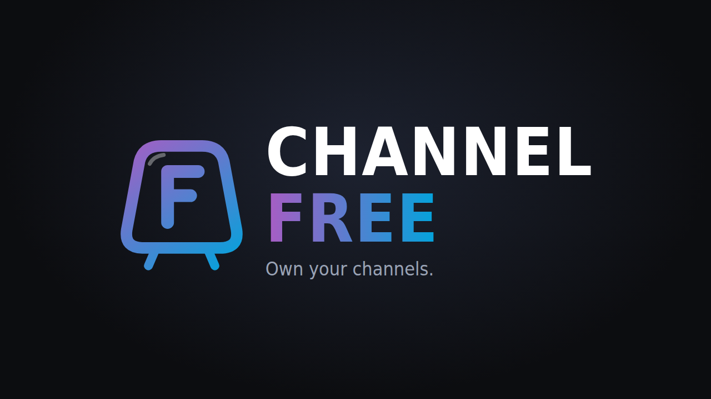

<p align="center"></p>

# Channel Free

**Your library, on the air.** Channel Free turns your Jellyfin movies and shows into live-TV channels in Jellyfin's own TV guide: shuffled sitcom reruns, a classic movie channel, Saturday-morning cartoons, a horror channel that gets spooky in October. Flip through channels like it's 2005. No contract. No hidden fees. No retention department.

- **Lightweight.** No extra containers or services. A channel only streams while someone is watching it.
- **Works in the Jellyfin apps you already use.** Roku, LG webOS, Android TV, web and mobile all play the channels through Jellyfin's Live TV.
- **Builds itself.** On install it looks at your library, turns on the 10 channels it can fill best and numbers them 101+.

## Install

1. In Jellyfin, open **Dashboard → Plugins → Repositories** (on older layouts, **Plugins → Catalog → ⚙**) and add:
   - **Name:** `Channel Free`
   - **URL:** `https://raw.githubusercontent.com/scooperman912-prog/ChannelFree/main/manifest.json`
2. Go to **Catalog**, find **Channel Free** under *Live TV*, and install it.
3. Restart Jellyfin.

Requires **Jellyfin 10.11** or newer.

## Set up (one time, about 2 minutes)

Open **Dashboard → Plugins → Channel Free → Setup & settings**. It shows two personal links.

1. **Dashboard → Live TV → Tuner Devices → +** → *M3U Tuner* → paste the **M3U** link → Save.
2. **Dashboard → Live TV → TV Guide Data Providers → +** → *XMLTV* → paste the **XMLTV** link → Save.
3. Wait for the green **Guide up to date** light at the top of the Channel Free page, then open **Live TV** in any Jellyfin app.

If Jellyfin can't reach itself at `http://localhost:8096` (custom port, reverse proxy, or a different network setup), change **Internal Jellyfin URL** in the settings first, then copy the links.

## Using it

**Your package** is every channel you get. Click a channel to manage it:

- **Shuffle | In order.** Shuffle mixes episodes across seasons and keeps two-parters together. In order plays by release date and loops.
- **Even mix | Weighted mix.** Weighted lets you rank shows left to right so your favorites air more often. Tonight's Mix shows each show's share of airtime.
- **Episodes in a row.** Airs 2 or 3 episodes of a show back-to-back, like a sitcom block. You can also set it per show from the ⋯ menu.
- **+ Add to channel.** Add single titles or whole collections, or bring in every title from a genre, network/studio or keyword tag (new ones join automatically). **Keep out** blocks a genre, network or tag from that channel.
- **↻ Rebuild schedule.** Re-plans everything after what's on now. Wait for the green light before reloading the guide on your TVs.

**On the remote:** in the TV guide, press **Record** on what's on now to restart it, or on a later program to jump to it. Back out within the revert window and the channel returns to what was on before.

**While watching:**
- A 5-second info banner shows the channel, title and time left when you tune in.
- An optional "Up Next" bumper plays between programs.
- End credits are cut short when a credits marker exists (from Intro Skipper or a "Credits" chapter).

**Tags you can add in Jellyfin's metadata editor:**
- `cable:<channel key>` adds a title to a channel.
- `cable:exclude` keeps a title off every channel.
- `cable:keep-credits` plays a title's credits in full.

### Built-in channels

| Channel | Picks from your library |
|---|---|
| After Hours | Grown-up animated shows (TV-14/TV-MA) |
| Saturday Morning | Kids' animated shows |
| Action Pack | Action, thriller, crime and war movies (1985+) |
| Classic Cinema | Movies made before 1985 |
| Tearjerkers | Romance and TV movies |
| Prestige TV | Acclaimed and HBO-studio shows plus acclaimed movies |
| Fright Night | Horror, plus Halloween episodes in October |
| Kids Classics | Family and animated movies with kids' ratings |

There's also one **genre channel** for every genre with 15+ movies and one **network channel** for every network with 4+ shows. You can create your own channels too. Everything can be renamed and renumbered.

## Playback and hardware

Channels are encoded on the fly to H.264, 720p by default, using **VA-API** (Intel/AMD, `/dev/dri/renderD128`) when it's available. If it isn't, Channel Free falls back to software encoding (x264). To use VA-API in Docker, pass `/dev/dri` through to the Jellyfin container. Bitrate, banner, credits, bumpers and audio language settings are all under **Setup & settings**.

## Build from source

```bash
git clone https://github.com/scooperman912-prog/ChannelFree
cd ChannelFree
JELLYFIN_PLUGINS=/path/to/jellyfin/config/plugins JELLYFIN_CONTAINER=jellyfin bash scripts/build-and-install.sh
```

The script builds inside the official .NET 9 SDK Docker image, so you don't need .NET installed. Releases are built by GitHub Actions: pushing a tag `v<version>` (matching `meta.json` and the `.csproj`) builds the zip, creates the GitHub release and adds it to `manifest.json`.

## License

GPLv3. See [LICENSE](LICENSE). Bundled DejaVu fonts are under their own license (`Fonts/LICENSE_DEJAVU`). The bumper stinger is original, generated by `Sounds/make-stinger.py`.

Channel Free is a community plugin and isn't affiliated with Jellyfin. Network and studio names only appear when they come from your own library's metadata.
